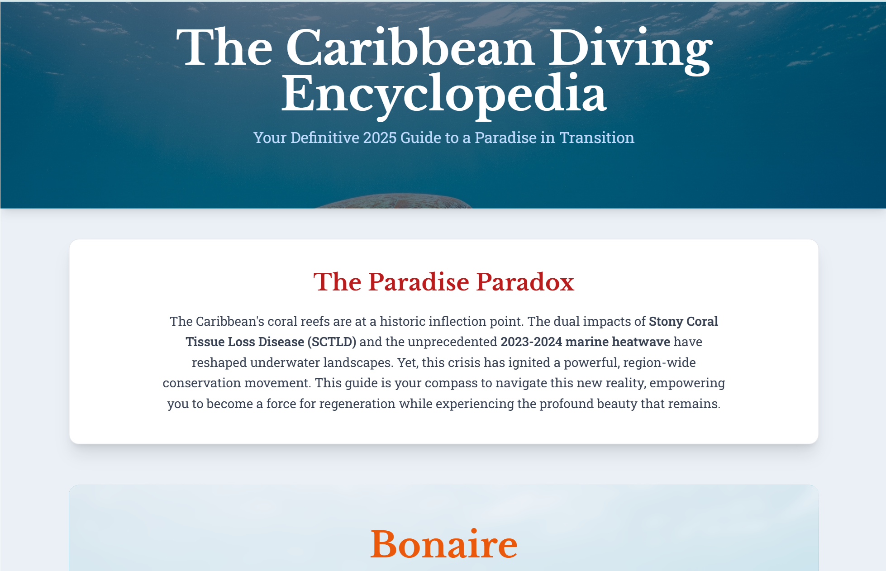

# The Caribbean Diving Encyclopedia 2025

<p align="center">
  
  
  
</p>

<p align="center">
  An interactive guide to Caribbean scuba diving in 2025: reef health, conservation and eco-tourism.
</p>

---

<p align="center">
  <a href="https://joshtol.github.io/caribbean-diving-guide-2025/">
    
  </a>
  <br>
  <strong><a href="https://joshtol.github.io/caribbean-diving-guide-2025/">View the Live Site</a></strong>
</p>

---

## The project

A guide for scuba divers planning a Caribbean trip, with the state of the reefs after recent ecological damage, and what divers can do to help.

## How it was made

I am not a diver. I built this as an experiment in AI-assisted development: a set of AI agents did the research, wrote the content and wrote the code, and I directed and reviewed the work.

- **An orchestrating agent** broke the work into tasks and handed them to the others.
- **Research agents** gathered the ecological and travel material the content draws on.
- **Coding and writing agents**, among them Qwen3 Coder, built the page and drafted the text, using Gemini CLI, Google Code Assist and OpenRouter.

An experienced diver then checked the content for accuracy.

## The page

- One `index.html`, in semantic HTML5, styled with Tailwind CSS, responsive down to a phone.
- Metadata, Open Graph tags, ARIA roles and JSON-LD structured data.

## How to run locally

1.  Clone the repository:
    ```bash
    git clone https://github.com/joshtol/caribbean-diving-guide-2025.git
    ```
2.  Go to the project directory:
    ```bash
    cd caribbean-diving-guide-2025
    ```
3.  Serve it from a local web server so the images load. In VS Code, the **Live Server** extension does this.

---

<p align="center">
  Created by <a href="https://github.com/joshtol"><strong>joshtol</strong></a>, with AI agents.
</p>
